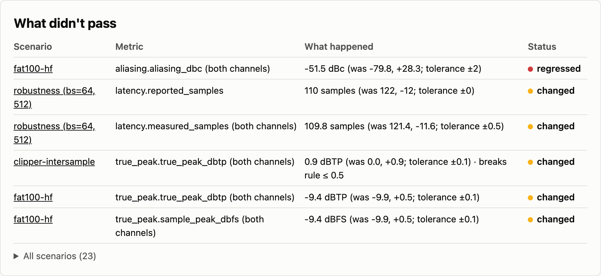
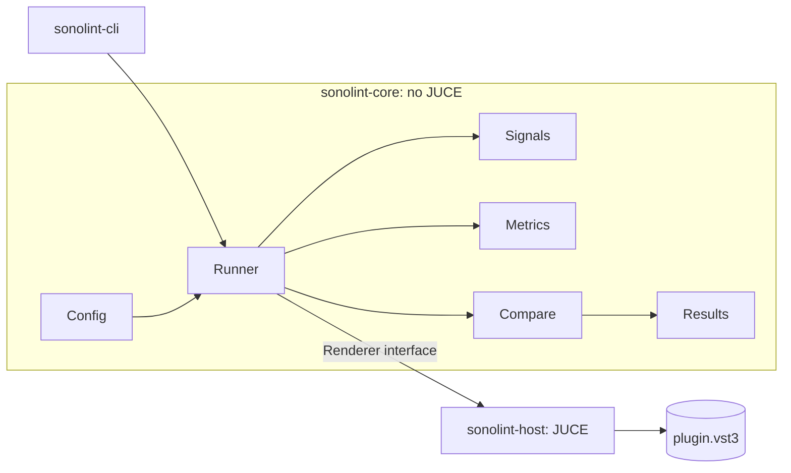

# Sonolint

**pluginval tells you your plugin won't crash. Sonolint tells you it still sounds the same.**

[](https://github.com/Remaori/Sonolint/actions/workflows/ci.yml)
[](https://github.com/Remaori/Sonolint/releases)
[](LICENSE)

Sonolint runs your compiled VST3 like a DAW would, measures how it sounds and flags
changes in every pull request. Despite the name, it doesn't read your code: it renders
audio and measures it.



*What Sonolint says of [Heft](https://github.com/Remaori/Heft), a compressor and
saturator, with its oversampling lowered from 4x to 2x. Halving oversampling cut CPU by
25% (median of 5 runs on an M-series Mac), and Sonolint caught +28 dB of aliasing.*

## Quick start

Until v0.1.0 is out, use `@v0.1.0-rc.4` where the documentation says `@v0`.

1. **Say what to test** in a `sonolint.yml` at the root of your repository: signals,
   parameter values and the metrics to measure, with optional fixed limits
   ([CONFIG.md](docs/CONFIG.md)). The [one for Heft](examples/heft/sonolint.yml) has
   23 scenarios.

   ```yaml
   version: 1
   scenarios:
     - id: transparent-1k
       params: { Drive: 0.0 }       # your plugin's parameters, by name
       signal: { type: sine, freq_hz: 1000, level_dbfs: -6 }
       metrics: [level, harmonics]
       expect:
         level.gain_db: { approx: 0.0, tol: 0.1 }
   ```

2. **Make the baseline**, the accepted values every pull request is compared with, on
   the same runner that will compare: run the Action with `mode: baseline` from a
   workflow you start by hand, download `baseline.json` from its artifact and commit
   it as `sonolint/baseline.json` ([how](docs/ACTION.md#making-the-baseline)).

3. **Add the job** after the one that builds your plugin:

   ```yaml
     sonolint:
       needs: build
       runs-on: windows-latest
       permissions:
         contents: read
         pull-requests: write
       steps:
         - uses: actions/checkout@v7
         - uses: actions/download-artifact@v8
           with:
             name: MyPlugin-VST3
             path: build/vst3
         - uses: Remaori/Sonolint@v0.1.0-rc.4
           with:
             plugin: build/vst3/MyPlugin.vst3
   ```

Every pull request then gets a comment with what changed, edited on each push, and the
job fails when a value moved past its tolerance or broke a limit. When a change of
sound is intended, [accept it](docs/ACTION.md#accepting-a-change-of-sound) with a new
baseline.
[ACTION.md](docs/ACTION.md) has the inputs and outputs. The same `sonolint` executable
runs on your machine; download it from
[Releases](https://github.com/Remaori/Sonolint/releases).

## What it measures

| Group | What it tells you |
| --- | --- |
| `level` | Peak, RMS, gain and DC offset |
| `true_peak` | The peak between samples, and the sample peak |
| `harmonics` | THD, THD+N and the 2nd to 10th harmonics of a sine |
| `aliasing` | Harmonics above half the sample rate that fold back below it |
| `frequency_response` | Magnitude at each step of a stepped sine; phase for information |
| `latency` | The latency the plugin reports against the one measured |
| `determinism` | Whether two renders of the same input are identical |
| `block_invariance` | Whether the output depends on the block size |
| `cpu` | Real-time factor, share of a core and the slowest blocks; shown, never compared |
| `silence` | Noise floor and peaks with no input |

Each value is compared with the baseline channel by channel, with a tolerance per
metric. Every definition is in [METRICS.md](docs/METRICS.md).

## What it tests, and what it doesn't

Sonolint tests the compiled plugin from the outside, as a black box: the same `.vst3`
a user installs, with known signals in and measurements out. It can tell that the
sound changed, where and by how much, but not which line of code changed it. It
complements [pluginval](https://github.com/Tracktion/pluginval), which checks that a
plugin is stable and follows the format, and frameworks such as
[HART](https://github.com/daleonov/HART), which test DSP code from the inside in C++.

## The HTML report

The table at the top of this page opens `report.html`. Below it, each scenario has its
values against the baseline and charts of the frequency response and the harmonics, with
what passed folded. It is one file that opens without internet, in light and dark, and
comes in the artifact of every run with `results.json` and `junit.xml`.

## How it works



The core reads the config, makes the signals, measures and compares, and never
touches JUCE, so it is tested in a fraction of a second with a fake renderer. The host
loads the VST3 with JUCE and renders each scenario on a fresh instance of the plugin.
More in [ARCHITECTURE.md](docs/ARCHITECTURE.md) and the decision records in
[docs/adr](docs/adr).

## Known limitations

- Windows x64 and macOS only; no Linux yet.
- VST3 effects only: no instruments or MIDI, no AU or CLAP.
- The plugin runs inside Sonolint's process, so a plugin that crashes ends the run. A
  plugin that hangs is stopped by a timeout, and the results so far are kept.
- Every channel gets the same signal, so swapping left and right goes unnoticed.
- Values come from one kind of runner: a baseline made on `windows-latest` compares
  only there. A new runner image can move the last decimals.
- CPU is shown but never compared in CI: runners with the same label change processor
  from one run to the next.
- The binaries are not code-signed.

## Roadmap

- **v0.1.1:** the comment says how to accept a change of sound that was intended,
  also for pull requests from forks.
- **v0.2, to be settled after this release:** null tests against reference WAV files,
  loudness (BS.1770-4) and static curves, intermodulation, tone bursts for attack and
  release, `sonolint init` to start a config from a plugin's parameters, parameter
  automation during the render, a spectrum in the HTML report with the aliasing
  components marked, `sonolint report` to make the reports again from `results.json`,
  a configurable relevance threshold per metric (-130 dB by default) below which values
  count as equal, a guide to writing a good `sonolint.yml`, and VST3 on Linux, which
  helps only plugins that also build on Linux, and many don't.
- **Later:** one comment for a whole matrix of runners, AU, instruments, each plugin in
  its own process, high-resolution frequency response with exponential sweeps, and the
  history of every metric on GitHub Pages.
- **To look into:** CLAP. First, whether JUCE 9 can host CLAP plugins; if it can't, it
  would take a separate host built on the CLAP SDK.

## Building from source

CMake 3.25 or newer and a C++20 compiler; the dependencies are downloaded at pinned
versions. `cmake --workflow --preset macos` builds a universal binary and runs every
test; on Windows, `cmake --workflow --preset windows` or `.\build.ps1`.

## License

Sonolint is licensed under the [GNU AGPL v3](LICENSE). It is built with JUCE, and the
notices and licences of every third-party component are in
[THIRD_PARTY_NOTICES.txt](THIRD_PARTY_NOTICES.txt). VST is a registered trademark of
Steinberg Media Technologies GmbH.
