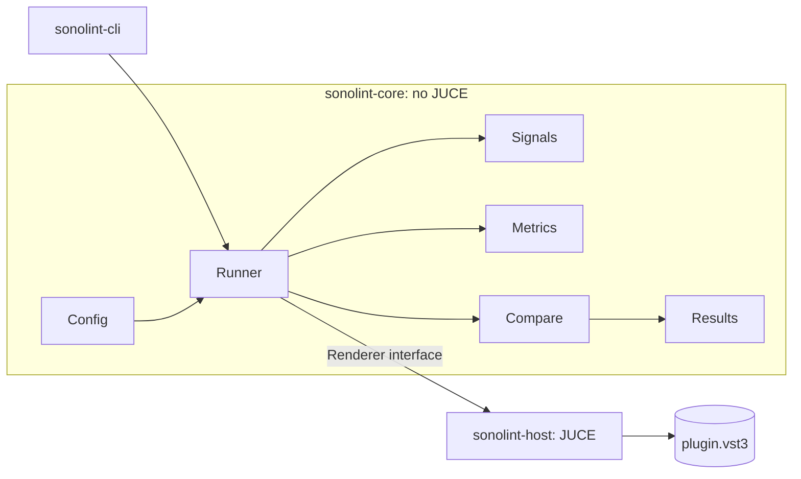

# Architecture

Sonolint is split in two: a core that knows what to measure and never touches JUCE,
and a host that knows how to run a plugin. The core asks for audio through one
interface, `Renderer`, so everything except the hosting can be tested in a fraction
of a second with a fake renderer and no plugin.

| Module | Folder | What it does |
| --- | --- | --- |
| `sonolint-core` | `src/core/` | Reads `sonolint.yml`, makes the test signals, runs the scenarios, measures, evaluates `expect`, compares with the baseline and builds the results. A static library with no JUCE |
| `sonolint-host` | `src/host/` | Implements `Renderer` with JUCE: loads the VST3, sets buses, state and parameters, and processes block by block |
| `sonolint-cli` | `src/cli/` | The `sonolint` executable: arguments, commands, exit codes |
| GitHub Action | `action.yml`, `scripts/` | Downloads a release, runs `sonolint run`, comments on the pull request ([ACTION.md](ACTION.md)) |

CMake keeps the core honest: it links no JUCE target, and the `core-linux` CI job
builds it with `-DSONOLINT_CORE_ONLY=ON`, which never downloads JUCE.

## Inside the core

| Folder | Contents |
| --- | --- |
| `config/` | The strict parser of `sonolint.yml`, matrix expansion, `--filter` |
| `signals/` | The signal generators and the random number generator |
| `analysis/` | One file per metric group, plus the FFT and what they share |
| `runner/` | The `Renderer` interface and the runner that drives a scenario from signal to result |
| `compare/` | The catalog of fields with their units, directions and tolerances; the baseline file; the comparison and the statuses |
| `report/` | What is written for people and tools: the terminal table, `report.md`, `report.html` with its SVG charts, `junit.xml`, the parameter list |
| `io/` | WAV files |

## What `sonolint run` does

1. Reads and checks the config, expands the matrices and applies `--filter`.
2. Loads the plugin once to read its parameters, and checks that every parameter the
   config names exists.
3. For each scenario, on a fresh instance of the plugin:
   1. makes the input signal;
   2. renders it: bus layout, real time or not, state, parameters, prepare, warm-up,
      then the signal and its tail;
   3. fails the scenario if the output has a NaN or an infinity;
   4. drops the latency the plugin reports, to line the output up with the input;
   5. measures what was asked, which for determinism, block invariance and CPU means
      rendering again;
   6. evaluates the `expect` rules.
4. Compares every value with the baseline, channel by channel, and gives each
   scenario its status.
5. Writes the reports that `--format` asks for, prints what didn't pass and exits
   according to `--fail-on`. Every report is made from the results alone.

`sonolint baseline update` does steps 1 to 3 and writes the values as the baseline of
the platform it runs on.

Scenarios run one after another in the same process. A watchdog on another thread
ends the run if one of them hangs, after saving the results so far.

The main thread acts as JUCE's message thread and no message loop runs
([ADR 0013](adr/0013-no-message-loop.md)).

## Tests

| Kind | Folder | What it checks |
| --- | --- | --- |
| Unit | `tests/unit/` | The core alone, against cases with a known answer and with a fake renderer |
| Test plugin | `tests/fixtures/` | A minimal VST3 effect with five behaviours whose results are known exactly ([ADR 0020](adr/0020-one-test-plugin.md)) |
| Integration | `tests/integration/` | The real binary run against the test plugin, reading the `results.json` it writes |
