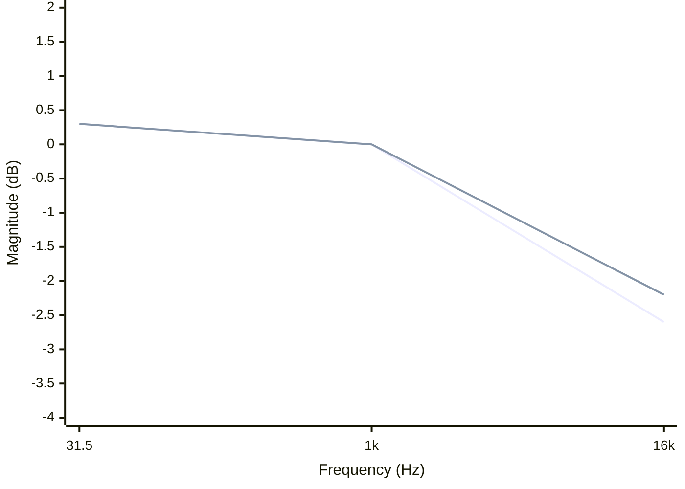

<!-- sonolint:report -->
## Sonolint · Example 1.2.3 · macos-arm64

**1 error · 1 regressed · 1 changed · 1 assertion_failed · 1 removed · 1 improved · 1 new · 1 pass**

| Scenario | Metric | Baseline | Actual | Δ | Tolerance | Status |
| --- | --- | --- | --- | --- | --- | --- |
| nan |  |  | the output has NaN or infinite samples |  |  | error |
| thd-hot | harmonics.thd_db (channel 1) | -45.5 | -40 | +5.5 | 1 | regressed |
| fat50-response | frequency_response.magnitude_db (channel 1) | 3 points | 1 of 3 points outside | -0.4 (largest) | 0.1 | changed |
| fat50-response | frequency_response.magnitude_db (channel 2) | 3 points | 1 of 3 points outside | -0.4 (largest) | 0.1 | changed |
| transparent-1k | level.gain_db |  | -0.08 |  | rule: 0 within 0.05 | assertion_failed |
| quiet |  |  | in the baseline, but no longer in the config |  |  | removed |
| clip-4x | aliasing.aliasing_dbc (channel 1) | -45 | -50 | -5 | 2 + 2.5 % of the baseline | improved |

**Frequency response of fat50-response, channels 1 and 2.** First line: this run. Second line: the baseline.

All scenarios (8)

| Scenario | Status | Not passing |
| --- | --- | --- |
| fat50-response | changed | frequency_response.magnitude_db |
| transparent-1k | assertion_failed | level.gain_db |
| thd-hot | regressed | harmonics.thd_db |
| clip-4x | improved | aliasing.aliasing_dbc |
| nan | error | the output has NaN or infinite samples |
| quiet | removed | in the baseline, but no longer in the config |
| robustness | new |  |
| steady | pass |  |

---
[Full report](https://github.com/Remaori/Heft/actions/runs/123) · Sonolint 0.1.0 · Commit 0123456 (merged into main)
